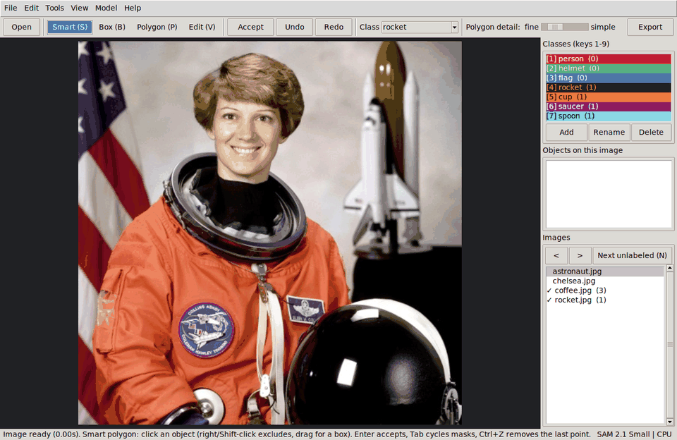
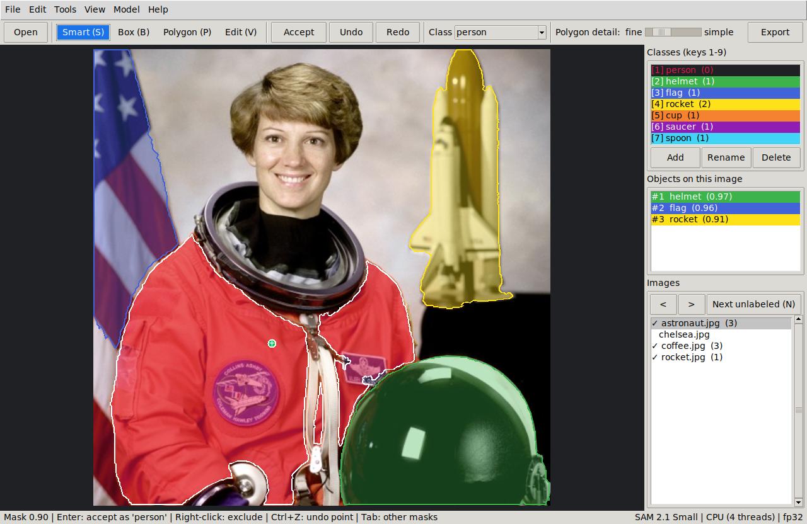
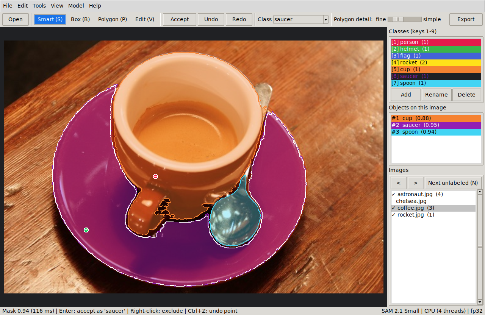
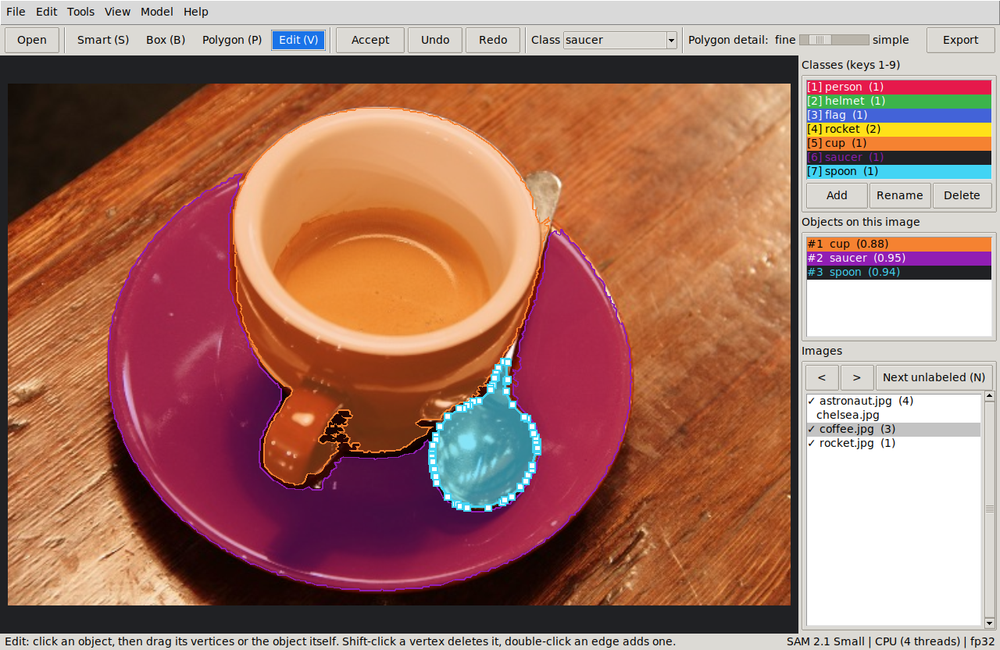

# SmartAnnotator

[](https://github.com/Kartik-A-1820/SmartAnnotator/actions/workflows/ci.yml)

A desktop tool for labeling instance segmentation datasets with Meta's Segment Anything models.
Hover over an object to preview its mask, click to keep it, refine with positive and negative points,
and export to YOLO or COCO. Built to stay responsive on modest hardware, including 4 GB GPUs such as the
GTX 1650 and CPU-only laptops.



## Features

- **Smart polygon tool**: hover preview, positive/negative point prompts, box prompts and alternative
  mask proposals, using SAM 2.1, SAM, MobileSAM, or the distilled EdgeSAM and EdgeTAM.
- **Manual tools**: bounding box, hand-drawn polygon, and a vertex editor (move, insert, delete).
- **Hardware-aware model selection**: detects the GPU and its memory, picks a model that fits, downloads
  the checkpoint and runs it in fp16 where the GPU supports it at full speed.
- **Projects that survive restarts**: atomic autosave next to the images, undo/redo (500 steps) including
  class edits, and reopening resumes at the first unlabeled image.
- **Export** to YOLO segmentation, YOLO detection or COCO, with deterministic train/val/test splits,
  EXIF orientation handled and a ready-to-train `data.yaml`.

## Screenshots

All masks below were produced by SAM 2.1 Small running on CPU. The screenshots are rendered by
[`scripts/render_screenshots.py`](scripts/render_screenshots.py), which drives the real app with
synthetic input; the [Screenshots workflow](.github/workflows/screenshots.yml) re-renders them on demand.
Sample photos are from scikit-image's public-domain data set.

| | |
|---|---|
| **One click.** The mask preview (white outline) appears before accepting; saved masks are tinted with their class color. |  |
| **Negative point.** A positive click on the saucer plus a right-click on the cup removes the cup from the mask. |  |
| **Edit tool.** The selected object shows draggable vertex handles. |  |

## Performance

Measured on a 6000×4000 photo (24 MP) using a 4-thread CPU and no GPU, with SAM 2.1 Small unless noted.
The interactive costs are dominated by the mask decoder, which is small, so a GPU mostly speeds up the
one-time image encoding.

| Operation | Naive approach | SmartAnnotator |
|---|---|---|
| Image encoder | rerun on every click (9.8 s with SAM ViT-B) | once per image (1.4 s), cached, next image pre-encoded |
| Click → mask → polygon | ~10 s | 40–60 ms |
| Hover → preview on screen | n/a | ~110 ms |
| Redraw while panning or zooming | resize the full image | 20–30 ms |

The model weights were randomly initialized for these runs, because the benchmark machine could not
download checkpoints. That does not change the amount of computation, which is what is being measured.

## How it works

```
 Tk main thread                                 inference thread
 ──────────────                                 ────────────────
 tools (smart / box / polygon / edit)  ──req──▶  coalescing slots: load > predict > encode > hover > prefetch
 viewport renderer (visible region only)         SamEngine: LRU cache of image embeddings
 project + undo history + autosave     ◀──evt──  mask decoder at working resolution → polygons
```

- **The encoder runs once per image.** SAM's image encoder accounts for nearly all of its compute
  (9.8 s versus 40 ms for the decoder in the measurements above). `SamEngine` caches
  encoder outputs per image (LRU), so every click only runs the lightweight mask decoder. The next image
  is encoded in the background once the user pauses, so moving to it is instant.
- **Masks are decoded at working resolution.** Upsampling three candidate masks to 24 MP and tracing
  their contours took over 3 s per click. Masks are now produced at a resolution matched to the polygon
  simplification tolerance (about 1600 px), then the polygons are scaled back. The adapters do this by
  remapping the predictor's original-size field, so the backends need no patches. A test checks the
  result against full-resolution decoding.
- **The UI never blocks.** All model work happens on one worker thread. Requests are coalesced rather
  than queued: only the newest prediction and the newest hover preview are kept, so a fast mouse movement
  costs one decoder run instead of dozens. Results are matched against request ids, so stale masks never
  appear.
- **Rendering touches only what is visible.** Each frame resamples just the on-screen part of the image,
  zoomed-out views of large images use a downscaled copy, and overlay-only redraws reuse the cached
  frame.
- **Undo is cheap.** Annotation lists are immutable values, so a history entry holds references to the
  before and after lists of one image instead of a copy of the whole project.

## Getting started

Requires Python 3.10+ and Tk (bundled with Python on Windows and macOS; `sudo apt install python3-tk` on
Debian/Ubuntu).

```bash
git clone https://github.com/Kartik-A-1820/SmartAnnotator.git
cd SmartAnnotator
pip install torch torchvision    # pick the CUDA or CPU build for your machine at pytorch.org
pip install -e ".[sam2]"          # SAM 2.1; add ",sam" for the original SAM
smartannotator path/to/images     # or: python app.py path/to/images
```

Checkpoints download on first use into `~/.cache/smartannotator` (set `SMARTANNOTATOR_CHECKPOINTS` to
change it). For offline machines, place the `.pth`/`.pt` file there or in `./checkpoints`.

Command-line options:

```
smartannotator [images ...] [--model KEY] [--device auto|cuda|mps|cpu] [--precision auto|fp16|fp32]
```

## Usage

1. Open a folder (Ctrl+O). Classes and annotations from earlier sessions are restored.
2. Add classes in the side panel and switch between them with keys 1–9.
3. With the Smart tool (S), hover over an object and click it. Add more of the object with left-clicks,
   exclude regions with right-click or Shift+click, or drag a box around it. Tab cycles alternative masks.
4. Press Enter to accept. Use D / N to go to the next image or the next unlabeled one.
5. Export with Ctrl+E.

| Action | Input |
|---|---|
| Smart polygon / Box / Polygon / Edit tool | S / B / P / V |
| Include / exclude region | Left click / Right click or Shift+click |
| Box prompt (Smart) or box annotation (Box) | Left drag |
| Accept mask, close polygon | Enter or Space |
| Remove last point or vertex | Ctrl+Z or Backspace |
| Alternative masks | Tab |
| Edit: move vertex or object / add vertex / delete vertex | Drag / Double-click edge / Shift+click vertex |
| Delete object, set object to current class | Del, C |
| Zoom, pan, fit | Wheel, Middle drag or Ctrl+drag, F |
| Undo, redo | Ctrl+Z, Ctrl+Y |

The full list is under Help > Keyboard Shortcuts (F1).

## Models

Model > Auto picks the first installed model from a per-hardware preference list:

| Hardware | Auto choice |
|---|---|
| GPU with 10 GB+ | SAM 2.1 Large |
| GPU with 6–10 GB | SAM 2.1 Base+ |
| GPU with 3–6 GB (GTX 1650 / 1650 Ti, RTX 3050 4 GB) | SAM 2.1 Small, fp16 |
| CPU only | MobileSAM, then SAM 2.1 Tiny |

Any model can be chosen from the Model menu or with `--model`:

| Key | Model | Size | Install |
|---|---|---|---|
| `sam2.1_tiny`, `sam2.1_small`, `sam2.1_base_plus`, `sam2.1_large` | SAM 2.1 | 149–857 MB | `pip install sam2` |
| `sam_vit_b`, `sam_vit_l`, `sam_vit_h` | SAM | 358 MB–2.4 GB | `pip install segment-anything` |
| `mobile_sam` | MobileSAM | 39 MB | `pip install git+https://github.com/ChaoningZhang/MobileSAM.git` |
| `edge_sam` (experimental) | [EdgeSAM](https://github.com/chongzhou96/EdgeSAM), distilled SAM | 38 MB | `pip install git+https://github.com/chongzhou96/EdgeSAM.git` |
| `edgetam` (experimental) | [EdgeTAM](https://github.com/facebookresearch/EdgeTAM), distilled SAM 2 | 54 MB | `pip install git+https://github.com/facebookresearch/EdgeTAM.git` |

Notes on the experimental models:
- They have much smaller encoders, so each new image is ready sooner, especially on CPU. Masks are
  somewhat less accurate than SAM 2.1.
- Auto never selects them.
- EdgeTAM installs as a fork of the `sam2` package, replacing it. It still ships the SAM 2.1 configs.
- EdgeSAM uses the NTU S-Lab license; check it before commercial use.

If fp16 produces invalid output on a particular GPU, the engine falls back to fp32 automatically.

## Export formats

| Format | Labels |
|---|---|
| YOLO segmentation | `{split}/labels/*.txt`, one instance per line: `class x1 y1 x2 y2 ...` (normalized). Multi-part objects are bridged into a single polygon. |
| YOLO detection | `{split}/labels/*.txt`: `class cx cy w h` |
| COCO | `{split}/annotations.json` with polygon segmentation, bbox and area |

Images are copied to `{split}/images`, with EXIF rotation applied to the pixels. YOLO exports include a
`data.yaml`:

```bash
yolo segment train data=path/to/export/data.yaml model=yolo11n-seg.pt
```

## Project layout

```
smartannotator/
  app.py          command-line entry point
  models.py       model registry, hardware detection, checkpoint download
  engine.py       backend adapters and SamEngine (embedding cache, working-resolution decoding)
  worker.py       background inference thread (request coalescing, idle prefetch)
  geometry.py     mask to polygon conversion and polygon utilities
  project.py      annotations, classes, undo/redo, project file
  export.py       YOLO and COCO writers, dataset splitting
  image_io.py     EXIF-aware loading and a shared decode cache
  settings.py     per-user preferences
  ui/
    main_window.py   layout, navigation, classes, history, rendering
    tools.py         Smart, Box, Polygon and Edit tools
    viewport.py      view transform and frame rendering (no Tk dependency)
    export_dialog.py
tests/            unit tests and end-to-end UI tests
```

## Development

```bash
pip install -e ".[sam2,sam,dev]"
ruff check .
python -m pytest            # on headless Linux: xvfb-run -a python -m pytest
```

The test suite has three layers:
- **Unit tests** for geometry, projects, export and the viewport.
- **Engine tests** that run the real SAM and SAM 2 architectures with random weights.
- **UI tests** that drive the Tk application with synthetic mouse and keyboard events. A stand-in model
  segments flat-colored shapes, so each tool's output can be checked exactly.

CI runs lint and the full suite on every push.
